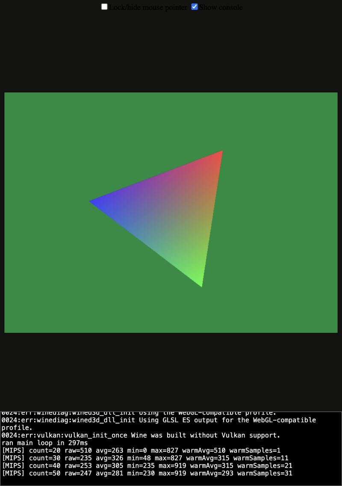

# YO2 Online in the browser (WASM feasibility)

Can players run the unmodified 2008 client in a browser tab instead of the Windows launcher? Short answer: **probably
yes**. The full stack works end to end with a stand-in exe. The real `yo2.exe` has not been tested yet.

## What runs where

| Piece | Today | Web version |
|---|---|---|
| `yo2.exe` (Win32, Direct3D 8, WinSock 1.1) | Windows | **Boxedwine** (x86 + Wine 11 compiled to WASM) in the tab. Its WineD3D build targets WebGL2. |
| Connect redirect (`version.dll`, `launcher/juego/dll`) | DLL proxy | The same DLL, unchanged. It builds with `i686-w64-mingw32-gcc ... -lws2_32 -lgdi32 -luser32`. In the guest, `127.0.0.1` is the gateway's own host. |
| libp2p / Tor tunnel (`launcher/sala`) | Go launcher | Boxedwine's `network-gateway.mjs`: guest TCP/UDP → WebSocket → real TCP. Run it next to the server. |
| Server (`run.py`, `yo2srv/`) | Python on host | Unchanged and native. Porting it to Pyodide isn't worth it: it uses blocking sockets, `threading` in 36 modules and listening ports, none of which Pyodide supports. |
| Duel engine (`duelcore`, ocgcore-wasm) | Node | Unchanged. It is already WASM, so it could move into the browser later, but the server stays authoritative. |
| Game files | Player's own folder | Player's own folder, never hosted. Boxedwine's shell can mount a local folder (File System Access API) or take an uploaded zip. |

## Proof (2026-10-25, Boxedwine master `2dbabfc`, Wine 11 web filesystem v22)

`yo2probe.c` is a small stand-in for `yo2.exe`. It uses the same imports (`d3d8.dll` + `WSOCK32.DLL`) and sends the
real gate handshake: `0x2005 "Ver.080912.00"` with the XOR+MD5 framing from `yo2srv/red/proto.py`. It runs inside the
browser and talks to an unmodified `run.py`.



The green background means the handshake succeeded. The server log shows the browser connection:

```
[srv:5730] <- 0x2005 #1 len=13 md5=ok ... b'Ver.080912.00'
[srv:5730] -> 0x2002 #1 len=4
[srv:5730] -> 0x2003 #2 len=1008 ... DuelCards     (the real server list)
```

| Build | Wine boot to window | Guest D3D8 frame rate | Page frame rate |
|---|---|---|---|
| `jit` (single-threaded) | ~40 s | ~800 fps | **~2 fps** (blocks the main thread, unusable) |
| `multiThreadedJit` | ~15 s | ~470 fps | 120 fps (display refresh) |

Use `multiThreadedJit`. It needs COOP/COEP headers (`server.mjs` sets them). CPU speed is roughly 250–900 emulated
MIPS. Boxedwine's own notes put MW3 (2011) at about 9 fps in the browser, so a 2008 2D/isometric client should fit.

## Real client (2026-10-25): title screen reached

The real `yo2.exe` Ver.080912 (its `merge.dat` matches `extraer_juego.py`'s SHA-256) ran in the same browser setup:

- The updater fetched `/yo2/root.txt` and `/yo2/merge.txt` from `run.py`'s HTTP port 8730 through the gateway.
- It showed the KONAMI logo, then the full **title menu rendered through D3D8 → WebGL**. Mouse hover worked.
- Clicking ONLINE didn't register yet. The client probably reads mouse buttons via DirectInput (`dinput8`), which may
  miss short synthetic clicks. This is the next thing to solve.
- The menu came up in German. The language setting still needs to be set the way the launcher does it.

Things that had to change:

- **The hook DLL needs the registry override.** `WINEDLLOVERRIDES=version=n,b` from the environment was ignored, and
  Wine kept loading builtin `version.dll`. `regedit /S` with `[HKEY_CURRENT_USER\Software\Wine\DllOverrides]
  "version"="native,builtin"` worked. Build the DLL with `build_dll.ps1`'s flags (`-nostdlib -ffreestanding
  -Wl,--entry,_DllMain@12 ... -lkernel32 -luser32 -lgdi32`).
- **Launch** through a `.bat`: `regedit /S yo2.reg`, `set YO2ONLINE_NET=1`, `yo2.exe`.
- **Sound on crashed the emulator** right after the client opened audio: `kpanic("Failed to queue SDL callback")`,
  meaning the main thread's SDL event queue was full. `sound=false` avoids it.

> ⚠️ **Memory.** Never pass the game as a single `app` zip with `storage=memory`. Boxedwine downloads the whole
> 1.1 GB zip into the page and copies it into its in-memory filesystem, so it takes several GB of RAM per load, and
> repeated reloads exhausted the test Mac's memory. Before testing again, serve the game lazily: Boxedwine's host-folder mount,
> or a fetch-on-read overlay. Leave out `Sound.dat` (416 MB) while sound is off.

## How to reproduce

```sh
git clone https://github.com/danoon2/Boxedwine && cd Boxedwine/project/emscripten
make multiThreadedJit                                   # emsdk on PATH
curl -LO https://boxedwine.org/v2/22/TinyCore15Wine11.0-web.zip
mkdir site && cp -R Build/MultiThreadedJit/* site/ && cp TinyCore15Wine11.0-web.zip site/boxedwine.zip
i686-w64-mingw32-gcc -O2 -std=c99 -mwindows yo2probe.c -o yo2probe.exe -ld3d8 -lwsock32 -ladvapi32
zip site/yo2probe.zip yo2probe.exe
node server.mjs --root site --port 8000 &
node network-gateway.mjs --port 8001 &                  # allows 127.0.0.1:* by default
(cd tools/yo2emu && YO2_NO_CLIENT=1 python3.12 run.py 0) &
open 'http://127.0.0.1:8000/boxedwine.html?app=yo2probe&p=yo2probe.exe&network=true&storage=memory&sound=false'
```

## Before trying the real client

1. **Delete the client folder's own `d3d8.dll`, `d3d9.dll` and `dxgi.dll`** (DXVK / d3d8to9, see `yo2net.c` line 16).
   Boxedwine sets `d3d8,d3d9,dxgi=n,b`, so a DLL next to the exe would win over the WebGL WineD3D, and DXVK needs
   Vulkan, which the browser doesn't have.
2. Load `version.dll` as native: `&env="WINEDLLOVERRIDES:version=n,b"`.
3. Allow the gateway every server port: gate 5730, accounts 5731-5732, rooms 5740-5750 and 5800-5876, duel 5760,
   HTTP 8730. The default `127.0.0.1:*` rule already covers these when the gateway runs on the server host.
4. Persistence: with emsdk 6.0.13 `IDBFS` isn't a global, so `storage=indexeddb` throws. Use `storage=memory` for
   now, or export `IDBFS` in the makefile so the 100 MB filesystem and saved data are cached between visits.
5. Known risk: an earlier attempt on a GPU-less Windows box couldn't create a D3D8 device under software dgVoodoo.
   This path is different (WineD3D → WebGL on the browser's GPU), and the probe's `CreateDevice` succeeds. Still, the
   client's exact present parameters and texture formats are untested.

## Hosting for real players

Put the static site (≈100 MB filesystem + 4 MB wasm) on any CDN that can send COOP/COEP headers. Run
`network-gateway.mjs` over `wss://` on the server box, with `--allow-origin https://<site>` and
`BOXEDWINE_GATEWAY_AUTH` set. The gateway replaces the launcher's libp2p/Tor reachability, so the server needs one
public WebSocket port. Each player brings their own `yo2.exe` folder; nothing from the game is ever served.
